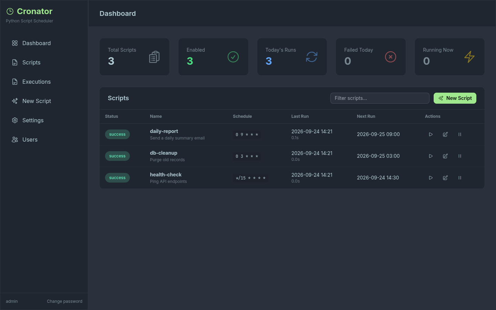
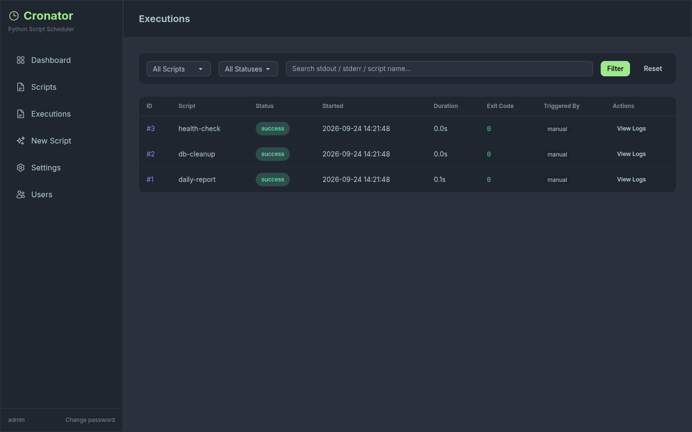
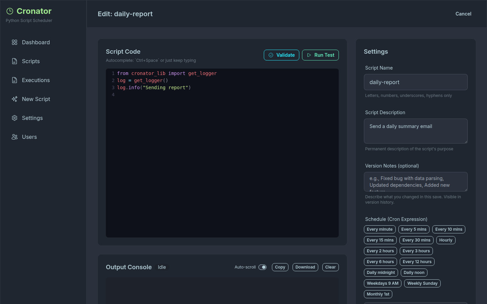
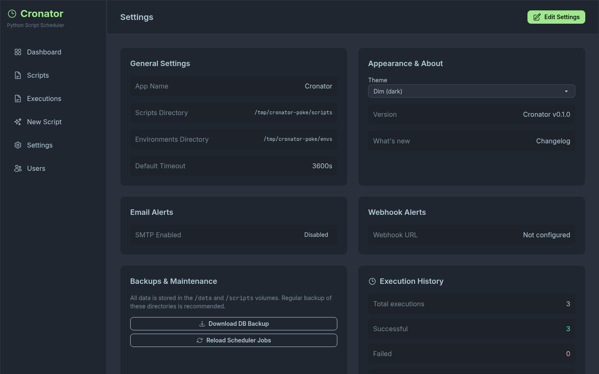

# Cronator

Run your recurring Python scripts on a schedule and watch what they do. Each
script gets its own virtual environment, its own cron schedule, and a stored
history of every run: status, output, exit code, duration.



[](LICENSE)
[](https://github.com/aa-blinov/cronator/actions/workflows/ci.yml)

---

## Quick start

Docker, with PostgreSQL:

```bash
git clone https://github.com/aa-blinov/cronator.git
cd cronator
cp .env.example .env
```

Set three values in `.env` before the first start: `ADMIN_PASSWORD`,
`SECRET_KEY` and `POSTGRES_PASSWORD`. The app refuses to start while
`ADMIN_PASSWORD` or `SECRET_KEY` still holds the placeholder value from
`.env.example`: `SECRET_KEY` derives the encryption key for the secrets
stored in the database, and a placeholder key is a published key.

```bash
docker compose up -d
```

Then open http://localhost:8080. The first start applies the Alembic
migrations, creates the admin account from `ADMIN_USERNAME` (default `admin`)
and the password you set, and starts the scheduler.

| Service | What it is |
| --- | --- |
| `cronator` | The application: web interface, REST API and scheduler in one process. |
| `db` | PostgreSQL 16, with a health check the app waits for on startup. |
| `db-backup` | A shell loop that dumps the database at 02:00 and prunes archives older than `BACKUP_RETENTION_DAYS`. |

Without Docker, on SQLite:

```bash
uv sync --all-extras
uv run alembic upgrade head
uv run python -m uvicorn app.main:app --reload --port 8080
```

`./start.sh` does the same thing and creates `.env` from `.env.example` when
it is missing. `start.ps1` and `start.bat` are the Windows equivalents.

## What it does

- **Schedule a Python script.** A five-field cron expression, one APScheduler
  job per script, evaluated in UTC.
- **Give each script its own environment.** One `uv` virtualenv per script,
  with its own Python version and its own dependency list, so two scripts can
  pin different versions of the same package.
- **Keep the history.** Every run is stored with its status, stdout, stderr,
  exit code, duration and the trigger that started it.
- **Watch a run as it happens.** Output is streamed over Server-Sent Events,
  and a reconnecting browser replays what it missed.
- **Retry a failure.** Retry count, delay and maximum window are set per
  script, and every attempt is recorded with its number.
- **Skip a run that would overlap.** With `prevent_overlap` on, a second run
  of a script that is still going is stored as a `skipped` execution instead
  of starting.
- **Alert on failure or on success.** Email over SMTP or a webhook POST, both
  switchable per script, with the failure alert throttled to one per hour.
- **Save files from a run.** `cronator_lib.save_artifact()` writes a file into
  the run's artifact directory; the interface lists it and serves it for
  download.
- **Keep the earlier versions.** Every save that changes the script stores a
  numbered snapshot, and any snapshot can be restored.
- **Work on several scripts at once.** Enable, disable or delete in bulk, with
  a result per script so one failure does not hide the rest.
- **See what needs attention.** The dashboard lists the scripts that failed
  today and the enabled scripts with no successful run in seven days.
- **Drive everything over HTTP.** A REST API with Basic Auth covers the same
  actions as the interface, and `/health`, `/metrics` and `/api/diagnostics`
  are there for monitoring.

## Screenshots

| Dashboard | Executions |
| :---: | :---: |
|  |  |

| Script editor | Settings |
| :---: | :---: |
|  |  |

## How it works

```
browser or curl
  -> SecurityHeadersMiddleware, CsrfOriginGuardMiddleware
  -> verify_credentials  (HTTP Basic, users table, environment fallback)
  -> app/api/scripts.py, app/api/executions.py   (JSON)
     app/api/pages.py                            (Jinja2 HTML)
  -> scheduler_service   (APScheduler, UTC)
  -> executor_service
  -> one OS process per run, in the script's own uv virtualenv
```

`app/main.py` builds the application, configures logging and runs the
lifespan: it waits for the database, runs the migrations, loads the settings
from the database, seeds the admin account, starts the scheduler, and marks
executions that were still running when the process last stopped as failed.

A run starts in `app/services/executor.py`. The request creates the
`executions` row with the status `running` and returns its id; the work
happens in a background task. The executor builds a minimal environment for
the child process (nothing of Cronator's own environment is inherited), runs
the script with `asyncio.create_subprocess_exec`, and reads stdout and
stderr line by line. Each line goes into the database and into an in-memory
replay buffer that serves the SSE stream. The timeout is enforced around the
read, so a script that hangs without printing anything is still stopped.

When the run ends, the row is updated, `last_success_at`, `last_failure_at`
and `consecutive_failures` are updated on the script, an alert is sent if the
script asked for one, a retry is scheduled if the failure counts allow it,
and the metrics counter moves.

`app/services/environment.py` owns the virtualenvs. It creates one with
`uv venv --python <version>`, resolves the requested packages with `uv pip
compile` before writing anything, installs `cronator_lib` in editable mode,
and then installs the script's own dependencies. The install streams its own
log lines to the browser over SSE.

The data model has eight tables: `scripts`, `executions`, `artifacts`,
`script_versions`, `script_audit_log`, `settings`, `users` and
`user_audit_log`. Every timestamp column is timezone-aware and the code works
in UTC throughout.

## Configuration

The environment is read once at startup by `app/config.py`. A subset of it is
copied into the `settings` table on first run and can then be changed from
the settings page without a restart.

| Variable | Default | What it does |
| --- | --- | --- |
| `ADMIN_USERNAME` | `admin` | Name of the admin account created on first start. |
| `ADMIN_PASSWORD` | none | Required. The app refuses to start while it holds the `.env.example` placeholder. |
| `SECRET_KEY` | none | Required. Derives the key that encrypts the SMTP password and the webhook URL at rest. |
| `DATABASE_URL` | `sqlite+aiosqlite:///./data/cronator.db` | The connection string. `docker-compose.yml` overrides it to point at the `db` service. |
| `PORT` | `8080` | Read by the container command, the health check and the port mapping. |
| `DEFAULT_TIMEOUT` | `3600` | Seconds a script may run before it is killed. A per-script timeout overrides it. |
| `MAX_LOG_SIZE` | `1000000` | Bytes of stdout and stderr kept per execution. The rest is truncated. |
| `MAX_ARTIFACT_SIZE_MB` | `10` | Largest file `save_artifact()` will write. |
| `MIN_FREE_SPACE_MB` | `100` | Below this much free space on the artifact volume, a run is refused with a failed execution. |
| `LOG_FORMAT` | `human` | `json` writes one JSON object per log line. |
| `LOG_LEVEL` | `INFO` | Level for the application logger. |
| `SMTP_ENABLED` | `false` | Turns the email alerts on. |
| `SMTP_PORT` | `587` | `465` uses direct SSL, any other port uses STARTTLS. |
| `ALERT_EMAIL` | none | Recipient of the failure and success alerts. |
| `BACKUP_RETENTION_DAYS` | `7` | Days of database dumps the `db-backup` service keeps. Docker only. |

`ADMIN_PASSWORD` and `SECRET_KEY` are environment-only on purpose: rotating
the secret key makes the stored secrets unreadable, so it is not a button in
the settings page. The full list is in
[docs/CONFIGURATION.md](docs/CONFIGURATION.md).

## Development

```bash
uv sync --all-extras                                   # install
uv run alembic upgrade head                             # migrate
uv run python -m uvicorn app.main:app --reload --port 8080   # run
uv run pytest tests/stateless tests/stateful -v         # fast path, SQLite
docker compose -f docker-compose.test.yml up --build --abort-on-container-exit --exit-code-from tests
uv run pytest tests/pg/ -v                             # against PostgreSQL 16
uv run pytest tests/ui/ -v                             # Playwright, needs a running app
uv run ruff check .                                    # lint
npm run build:css                                      # rebuild the Tailwind bundle
```

The Docker command is what CI runs: it builds the `tests` service against a
PostgreSQL 16 container and runs the whole suite inside it. The Playwright
tests in `tests/ui/` run on the host against a live stack and are excluded
from the default `testpaths`.

| Path | What it holds |
| --- | --- |
| `app/api/` | The routers: scripts, executions, settings, users, diagnostics, pages, locale. |
| `app/services/` | The execution engine, the scheduler, the virtualenv manager, alerting, backups, cleanup, metrics, settings. |
| `app/models/` | The SQLAlchemy models, one module per table. |
| `app/schemas/` | The Pydantic request and response models. |
| `app/templates/` | The Jinja2 pages. |
| `app/static/` | The Tailwind input, the compiled output, the front-end script, the favicon. |
| `app/script_templates.py` | The 19 built-in script templates. |
| `cronator_lib/` | The library every script imports: logging, artifacts, notifications, timing. |
| `alembic/versions/` | The migrations, one linear chain. |
| `tests/` | The suite, split into `stateless`, `stateful`, `pg` and `ui`. |

The longer reference is in [docs/](docs/README.md):
[architecture](docs/ARCHITECTURE.md),
[configuration](docs/CONFIGURATION.md),
[deployment](docs/DEPLOYMENT.md),
[operations](docs/OPERATIONS.md),
[security](docs/SECURITY.md),
[API](docs/API.md) and
[development](docs/DEVELOPMENT.md).

## License

MIT, © 2026 aa-blinov. See [LICENSE](LICENSE).
